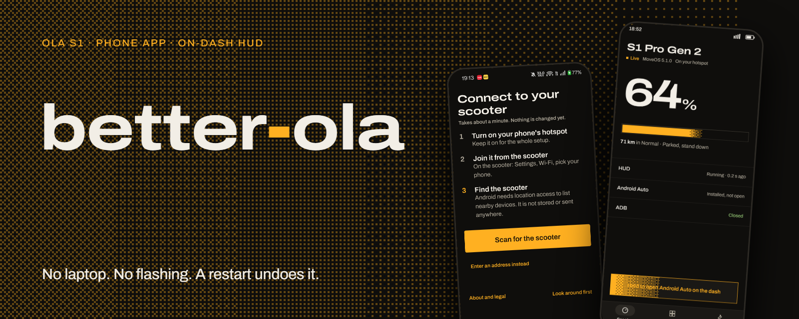
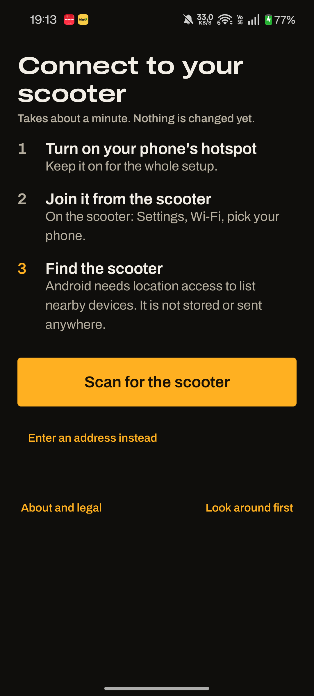
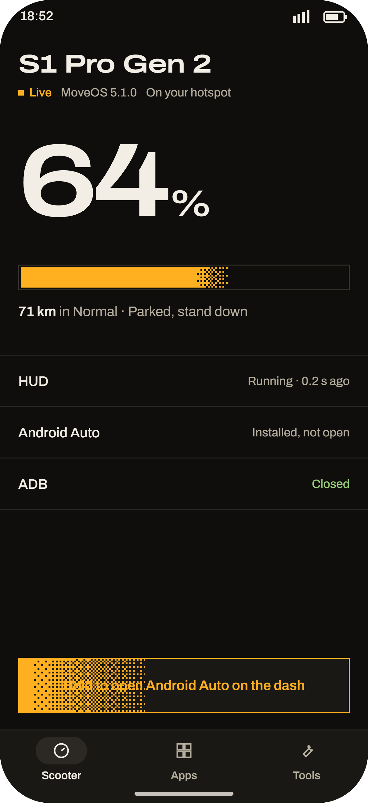
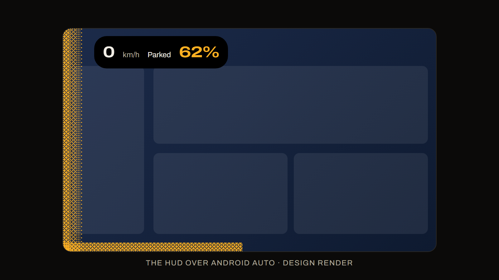

<p align="center"></p>

<p align="center">
<a href="https://a3ro-dev.github.io/ola-s1-air-mod/"><b>Website</b></a> ·
<a href="https://github.com/a3ro-dev/ola-s1-air-mod/releases"><b>Download</b></a> ·
<a href="legal/DISCLAIMER.md">Disclaimer</a> ·
<a href="CHANGELOG.md">Changelog</a>
</p>

better-ola is a phone app and an on-dash HUD for the Ola S1's Android head unit. It finds the scooter on your hotspot, installs and looks after the mods, and keeps the numbers that matter on screen while you use Android Auto.

No laptop. No flashing. A restart undoes the debug access.

> Not affiliated with, endorsed by, or connected to Ola Electric Mobility Ltd. "Ola", "MoveOS" and "S1" belong to their owners and are used only to say what this works with. Read [legal/DISCLAIMER.md](legal/DISCLAIMER.md).

## What's in it

| | |
|---|---|
| **better-ola** (`android/app`) | The phone app. Connects to the scooter, installs mods, shows live battery and range, and updates itself from GitHub Releases. |
| **better-ola HUD** (`android/hud`) | A transparent overlay for the scooter's display. Sits above Android Auto and never takes a touch. It's bundled inside the phone app so you don't install it by hand. |

<p align="center">

&nbsp;

</p>
<p align="center"><sub>Left: the connect screen on a real phone. Right: a design mockup of the Scooter tab, not a capture.</sub></p>

## The HUD

It's a thin layer over whatever is already on the screen, not a replacement dashboard.

<p align="center"></p>
<p align="center"><sub>Design render, not a photo from the scooter.</sub></p>

- **Top left:** speed, drive mode, charge and range in one pill. It sits left of Android Auto's search bar and tabs on purpose.
- **Screen edges:** amber ordered-dither glow for the indicators, a red strip for the brake.
- **Bottom edge:** a dithered power and regen meter. Amber when drawing power, green on regen, red under braking. Easy Park hatches it.
- **Messages:** the pill widens for the one thing worth saying, like side stand down, power reduced, charging, hazard lights or data stopped.
- **Never in the way:** the window is `FLAG_NOT_TOUCHABLE | FLAG_NOT_FOCUSABLE`, so every tap goes to Android Auto.
- **Cheap to draw:** ordered dither, no blur, no gradients, about 30 fps and only while something is moving. Animation is off when the system animation scale is 0.

Signals are decoded read-only from the scooter's own CAN broadcasts. Nothing in the HUD writes to the bus.

## The phone app

1. Turn on your phone's hotspot and join it from the scooter (Settings, Wi-Fi).
2. Open **better-ola**. It remembers the last scooter and reconnects on its own. The scan screen only shows up when nothing is saved or the scooter can't be reached.
3. Tap **Set up Android Auto and the HUD**. The app unlocks ADB in memory, installs the selected APKs, grants the permissions they need and sends the dash back to its home screen.
4. After that, **Hold to open Android Auto on the dash** does what it says.

Also in there:

- Live battery, range, mode, side stand and charging, from a listen-only CAN tap.
- Apps: install, reinstall or remove the bundled mods, or sideload any APK.
- Tools: dash screenshot, system info, settings shortcuts, a root shell and a check-for-updates button.
- **OTA updates:** on launch, and from Tools on demand, it asks GitHub for the latest release. If it's newer it downloads the APK and hands it to the system installer. Your saved scooter and settings stay.

### Android Auto in Self-Mode (AA 17.4 and later)

Android Auto 17.4 removed the automated Self-Mode launch that OpenHeadUnit and similar receivers used. The headunit server is the path that still works, and the app handles it:

1. It checks port `5277` on the phone.
2. If the server is off, it opens Android Auto settings and shows the one manual step, **three-dot menu, then Start headunit server**. If that item is missing, tap **Version** ten times at the bottom of the settings screen first.
3. It waits for the server, then opens Android Auto on the scooter by itself.

The **Android Auto link** row on the Scooter tab shows whether the server is up.

## Install

Download the latest `better-ola-*.apk` from [Releases](https://github.com/a3ro-dev/ola-s1-air-mod/releases), open it on the phone and allow installs from your browser or file manager when asked. The app carries the HUD APK and installs it on the scooter during setup.

You need an Ola S1 with the 7-inch Android touchscreen, the scooter on the same hotspot as the phone, and the side stand **up** with the screen awake while setup runs.

## Compatibility

| Model | Display | Head unit | MoveOS | Status |
|---|---|---|---|---|
| S1 Pro (Gen 2) | 7" 800×480 touch | Snapdragon 625 (`msm8953`) | 3, 4, 5 | Tested |
| S1 Pro (Gen 1) | 7" touch | Snapdragon 212 (`APQ8009`) | 2, 3, 4, 5 | Expected to work |
| S1 (Gen 1) | 7" touch | Snapdragon 212 (`APQ8009`) | 2, 3, 4, 5 | Expected to work |
| S1 Air | 7" 800×480 touch | Octa-core | 3, 4, 5 | Expected to work |

I've only tested the Gen 2 Pro. The rest is a guess from the hardware. Segmented-LCD and non-Android clusters aren't supported.

## Safety and undoing it

- ADB is authorised with an RSA key bind-mounted **in RAM**. No partition is written and a restart removes it.
- The app doesn't touch the power manager or the auto-lock, so the scooter still locks itself.
- The HUD only listens to CAN frames. It sends nothing.
- The dash and its physical warnings are the authority. Anything here can be late, wrong or blank, so glance only while riding.

`ola.py` is the same root channel from a computer, for when you want a shell:

```bash
python ola.py --help
```

## Build

```bash
cd android
./gradlew :app:assembleDebug
```

The HUD gets built first and copied into the app's assets, so the phone app can install it offline. Outputs:

- `android/app/build/outputs/apk/debug/app-debug.apk`
- `android/hud/build/outputs/apk/debug/hud-debug.apk`

Release builds use the debug signing key, which is fine for sideloading and OTA from these Releases. If you fork this for wider distribution, use your own key.

## Layout

```
android/
  app/       phone companion (Compose)
  hud/       dash overlay (custom View, no Compose)
  vehicle/   CAN decoding, tap, warning priority, shared by both
docs/        the website (GitHub Pages) and its poster sources
design/      app and HUD design notes and probe captures
legal/       disclaimer, privacy, third-party notices
ola.py       root gRPC CLI for the scooter
setup.py     legacy PC setup script
```

## Licence

MIT, see [LICENSE](LICENSE). Third-party signal tables and bundled mods are credited in [legal/THIRD-PARTY.md](legal/THIRD-PARTY.md).
